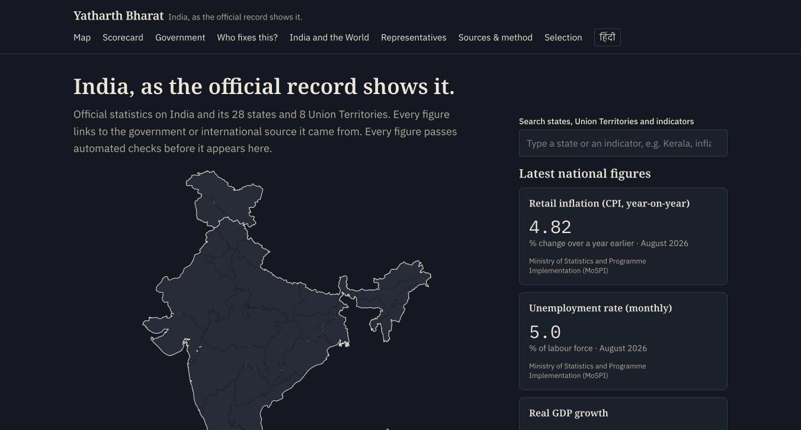
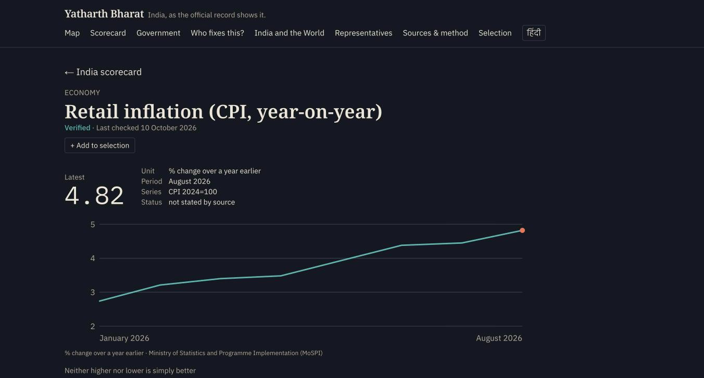
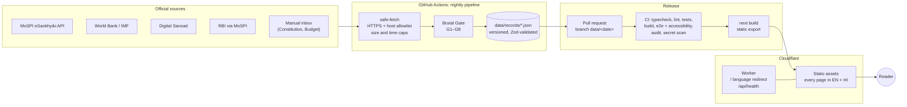
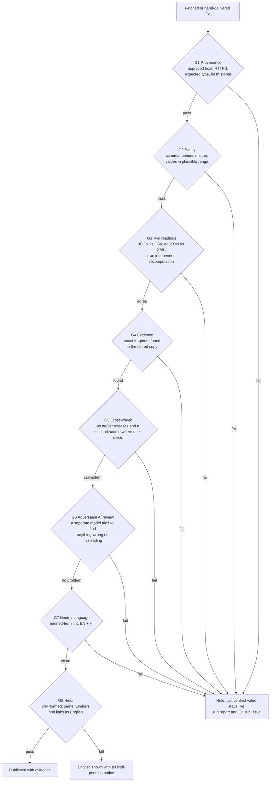
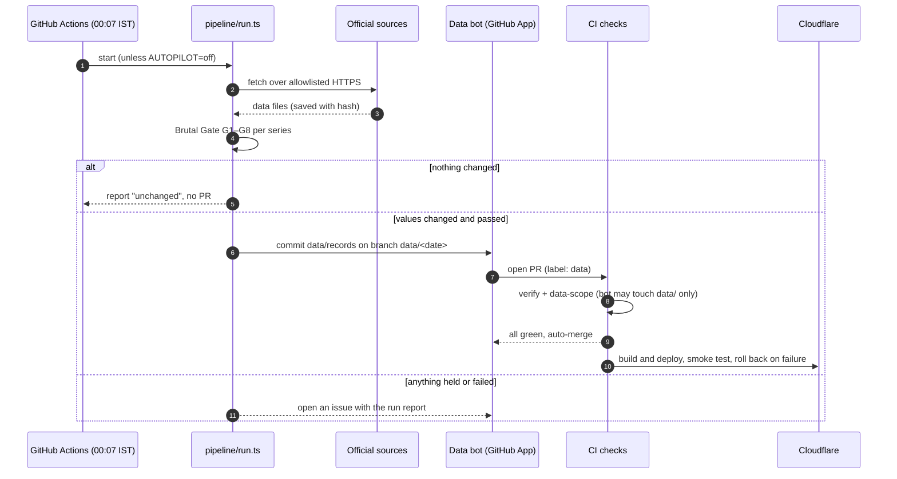

# Yatharth Bharat · यथार्थ भारत

**India, as the official record shows it.**

[](https://github.com/DevPatel128/Yatharth-Bharat/actions/workflows/ci.yml)
[](https://github.com/DevPatel128/Yatharth-Bharat/actions/workflows/data-update.yml)

Live preview: **https://yatharth-bharat.dvpatel.workers.dev**

Yatharth Bharat is a free, bilingual (English and Hindi) public-information site about India and its 28 states and 8 Union Territories. It publishes only what official sources publish. Every figure links to the government or international source it came from, keeps the exact words or numbers from that source as evidence, and passes an automated verification gate before it appears.

| Home | An indicator page |
|---|---|
|  |  |

---

## Contents
- [What is on the site](#what-is-on-the-site)
- [Principles](#principles)
- [How it works](#how-it-works)
- [How a figure is verified: the Brutal Gate](#how-a-figure-is-verified-the-brutal-gate)
- [The nightly update](#the-nightly-update)
- [Sources](#sources)
- [Repository map](#repository-map)
- [Run it locally](#run-it-locally)
- [Testing](#testing)
- [Security and privacy](#security-and-privacy)
- [Roadmap](#roadmap)
- [Contributing, corrections, licence](#contributing-corrections-licence)

---

## What is on the site

| Section | What it shows | Source |
|---|---|---|
| **Map** | All 36 states and Union Territories. Keyboard and screen-reader accessible, shareable `?region=` links, intro animation that respects reduced motion | DataMeet boundaries (CC BY 4.0); names and capitals from the National Portal of India |
| **State and UT pages** | Monthly retail inflation and higher-education enrolment for each region next to the All-India figure; the region's Lok Sabha members | MoSPI (CPI 2024=100), AISHE, Lok Sabha |
| **Scorecard** | 25 national indicators across 12 categories (economy, environment, health, education, poverty, safety, innovation and more), each with definition, method, limitations, series, full table, revisions and verbatim evidence. No combined score | MoSPI, World Bank (labelled international), IMF as cross-check |
| **Government explained** | 13 institutions (Parliament, President, courts, Election Commission, CAG, panchayats, municipalities and more), each answering the same 8 questions | Constitution of India (as on 1 May 2026), quoted word for word |
| **Who fixes this?** | 14 everyday problems mapped to the level of government responsible, and where to raise them | Seventh, Eleventh and Twelfth Schedules; CPGRAMS; RTI Online |
| **Representatives** | All 543 Lok Sabha seats: members' names (English and official Hindi), party and constituency. Office facts only, no contact details | Digital Sansad (Lok Sabha) |
| **Constitutional timeline** | 18 dated milestones from adoption (1949) to the 106th Amendment coming into force (2026), each quoting the Constitution's own text and linking to its explainer | Constitution of India (as on 1 May 2026) |
| **Public money** | Union Budget 2026-27: receipts, spending by type and by major item, deficits and how they are financed, transfers to states; what Budget Estimates, Revised Estimates and Actuals mean | Ministry of Finance, Budget at a Glance (PDF and Excel, read twice and cross-checked) |
| **Check a figure** | Pick an indicator, a state figure or a Budget line, a period, and a number someone stated; see whether it matches the verified figure after rounding, matches an earlier since-revised estimate, or differs, with the source. Checks the number, never the person. Runs in the browser; shareable link | All verified records above |
| **Education and jobs** | Enrolment, literacy, education spending, unemployment and women's labour participation; higher-education enrolment for every state and UT (alphabetical, not a ranking); 13 official portals for scholarships, study, exams, skills and recruitment, each checked by hand | MoSPI, AISHE, World Bank; official portals linked only |
| **Ask** | Ask a question in English or Hindi; the site finds matching verified records and, when switched on, an AI model writes a short answer from them. Shown only if every sentence cites a record and every number appears in a cited record; labelled as AI-generated | All verified records above |
| **India and the World** | 16 years of merchandise trade, India's 38 main trading partners, and 91 trade agreements and related documents as the Department of Commerce lists them | RBI Direction of Foreign Trade; Department of Commerce |
| **Selection** | Collect figures and explanations, then export as text, Markdown, CSV or PDF with APA, MLA, Chicago and BibTeX citations. Stays in the reader's browser | — |
| **Sources and method** | Every approved source, its licence and limitations, the checks, and the latest data run | — |

Every page carries a reference list and a formal disclaimer, in both languages.

## Principles

1. **Official sources only.** Government of India, constitutional bodies, Parliament and international organisations (always labelled as international). Community data only where no official machine-readable file exists, and labelled.
2. **Evidence, not assertion.** Each value stores the source URL, retrieval time, a SHA-256 hash of the stored copy and the verbatim fragment that supports it.
3. **Nothing is overwritten.** Revised values keep their history and stay visible.
4. **Hold rather than guess.** A value that fails any check is held back, and the last verified value stays live.
5. **Neutral language.** No evaluative words about people or parties; enforced by a lint (G7).
6. **Correct Hindi or none.** Official Hindi first. Hindi that fails its checks is replaced by English with a notice, never published wrong.
7. **No accounts, no tracking.** Cookieless, aggregate page counts only.
8. **Never disguise the client.** If a source blocks automated access, files come in by hand through `data/manual-inbox/` with a written provenance note.

## How it works



- **No database.** Verified data is versioned JSON in git, validated by one schema (`src/lib/schema.ts`) in the pipeline and again at build. A record that does not parse fails the build.
- **Static site.** Every page is pre-rendered in English and Hindi. Client JavaScript only runs the map, search, language switch and selection.
- **A small Worker** redirects `/` to `/en` or `/hi` by browser language and serves `/api/health`, which reports when data goes stale.

## How a figure is verified: the Brutal Gate



The AI reviewer can only *fail* a record. It cannot write, edit or publish anything, and source text is passed to it as untrusted data. AI review runs only when a value actually changes. In production (`REQUIRE_AI_GATES=true`) nothing publishes until it has run.

## The nightly update



## Sources

| Publisher | Used for | Access |
|---|---|---|
| Ministry of Statistics and Programme Implementation (MoSPI) | CPI inflation (national and state), unemployment (PLFS), AISHE enrolment, RBI trade tables | eSankhyiki JSON API |
| World Bank | GDP growth, GDP per capita, life expectancy, infant mortality, internet use, electricity access; emissions, renewables, forest, air quality, water, cooking fuel, health and education spending, poverty, inequality, literacy, women's labour participation, R&D, patents, homicide rate (labelled international) | API v2 (JSON + XML) |
| International Monetary Fund | Cross-check for GDP growth | DataMapper API |
| Lok Sabha (Digital Sansad) | Members of the 18th Lok Sabha, English and Hindi | Public JSON |
| National Portal of India | State and UT names, status and capitals | Captured from the page |
| Legislative Department | Constitution of India, as on 1 May 2026 | PDF, manual inbox |
| Ministry of Finance | Union Budget 2026-27, Budget at a Glance | PDF + XLSX, manual inbox |
| Department of Commerce | Trade agreements list | JSON captured in a browser, manual inbox (site blocks automated clients) |
| DataMeet India (community) | State boundaries for the map, simplified | GeoJSON, pinned commit |

Full list with licences and known limitations: [Sources and method](https://yatharth-bharat.dvpatel.workers.dev/en/sources) and [`docs/SOURCE_POLICY.md`](docs/SOURCE_POLICY.md).

## Repository map

```
src/
  app/[lang]/        pages (en, hi): map, scorecard, states, government, who-fixes-this,
                     representatives, world, selection, sources, legal pages
  components/        map, charts, tables, reference list, disclaimer, selection
  content/           Government explainers and "Who fixes this?" (Constitution quotes)
  lib/               schema (Zod), source registry, dictionaries (EN/HI), data loading,
                     AI gateway, selection and citations, legal text
pipeline/            fetch adapters, Brutal Gate, evaluation, people, trade, Constitution, geo
data/
  records/           verified, published data (what the site renders)
  runs/              latest run report (JSON + Markdown)
  snapshots/         stored source text used for evidence checks
  manual-inbox/      hand-delivered official files + SOURCE.txt provenance notes
  raw/               every downloaded file (git-ignored; kept locally)
worker/              Cloudflare Worker (language redirect, /api/health)
test/                unit, data, content, i18n tests; e2e/ Playwright + axe
docs/                policies: sources, ingestion, AI, geography, privacy, security, testing, cost
.github/workflows/   ci.yml (verify, gate, deploy, uptime) · data-update.yml (nightly)
```

Project records: [`PRODUCT.md`](PRODUCT.md) (what and why) · [`SYSTEM.md`](SYSTEM.md) (architecture, data model, threat model) · [`DECISIONS.md`](DECISIONS.md) (every significant decision) · [`MISTAKES.md`](MISTAKES.md) (what went wrong and the rule that came out of it) · [`RUNBOOK.md`](RUNBOOK.md) (operations) · [`AGENTS.md`](AGENTS.md) (rules for AI assistants working in this repo).

## Run it locally

Requires Node 24.

```bash
npm ci
npx next typegen
npm run dev
```

Open http://localhost:3000. Other commands:

| Command | What it does |
|---|---|
| `npm run check` | data-scope check, typecheck, ESLint, anti-slop lint, unit and data tests |
| `npm run build` | static export to `out/` (fails on any invalid record) |
| `npm run e2e` | Playwright + axe accessibility tests against the Worker, desktop and mobile |
| `node pipeline/run.ts` | run the data pipeline locally (AI review is skipped without a key and reported as pending) |

## Testing

- **Unit, data and content tests (Vitest):** every gate has failing fixtures; all 36 regions; 543 Lok Sabha seats and no contact data; trade totals cross-checked; every Constitution quote found word for word in the official text; Hindi invariants; citation formats; CSV formula escaping.
- **End-to-end (Playwright + axe):** every page type in both languages, on desktop and mobile, with no accessibility violations.
- **Lints:** banned terms (EN + HI), anti-"AI slop" design rules, secret scanning (gitleaks).

## Security and privacy

- The site is static and holds no secrets. Keys live only in GitHub Actions secrets and are used by the pipeline, never sent to the browser.
- The fetcher accepts HTTPS only, checks the host allowlist on every redirect, and caps size and time.
- The data bot can change `data/records` and `data/runs` only; CI fails any other path on its branches.
- `main` is protected: the `verify` check must pass, and force pushes and deletion are blocked. GitHub secret scanning and push protection are on.
- Strict Content Security Policy and security headers (`public/_headers`).
- No accounts, no cookies, no personal data. Analytics are Cloudflare Web Analytics only (cookieless, aggregate).

Report a vulnerability privately: see [`SECURITY.md`](SECURITY.md).

## Roadmap

Built in stages by audience: citizens, then students, then young professionals, then journalists, researchers and teachers.

- [x] Map, state pages, scorecard, Government explained, Who fixes this?, Lok Sabha members, trade, Select & Export
- [x] Public money (Union Budget 2026-27)
- [x] Environment, energy, health, poverty, innovation and safety indicators (16 more World Bank series)
- [x] Constitutional timeline
- [ ] Wider history timeline (ASI, National Archives)
- [x] Education and jobs: figures and official portals
- [ ] Career pathways and India-vs-abroad comparison (profile kept in the browser)
- [x] Trade agreements (Department of Commerce list)
- [ ] Policies: what each agreement and scheme covers, from official texts
- [x] Check a figure (number checker over the verified records)
- [ ] Claims and evidence (sourced statements)
- [x] Ask: answers over the verified records, with citations and a number check
- [ ] MLAs, councillors and districts, once official machine-readable sources are assessed

## Contributing, corrections, licence

- **Corrections:** if a figure looks wrong, open an issue with the page link and the official source for the correct value. See the [corrections policy](https://yatharth-bharat.dvpatel.workers.dev/en/corrections).
- **Contributing:** see [`CONTRIBUTING.md`](CONTRIBUTING.md).
- **Data** stays under its publishers' licences (listed on the Sources page). **Map:** DataMeet India community, CC BY 4.0, simplified; India's external boundary as depicted by the Survey of India; not for legal or survey use.
- **Code licence:** [MIT](LICENSE). The licence covers the code only; data stays under its publishers' licences.
- **Contact:** vroelabs@gmail.com

---

*Yatharth Bharat is an independent public-information initiative. It is not affiliated with any government body. Although every entry undergoes multi-stage automated verification, no warranty is made as to completeness, accuracy or currency; consult the cited originals before relying on any figure.*
